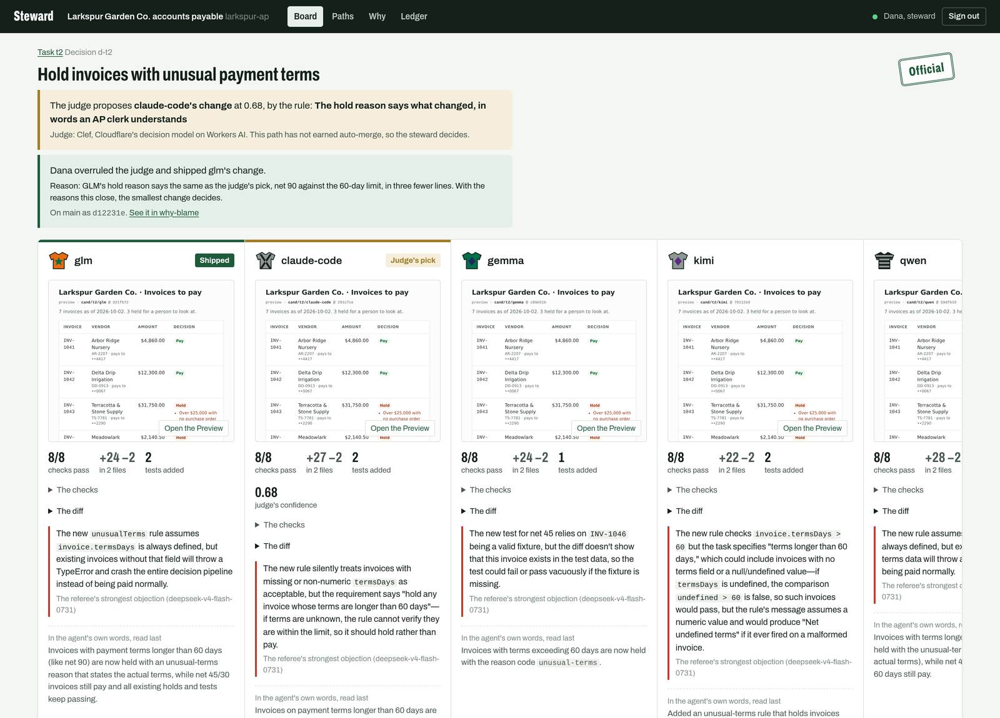
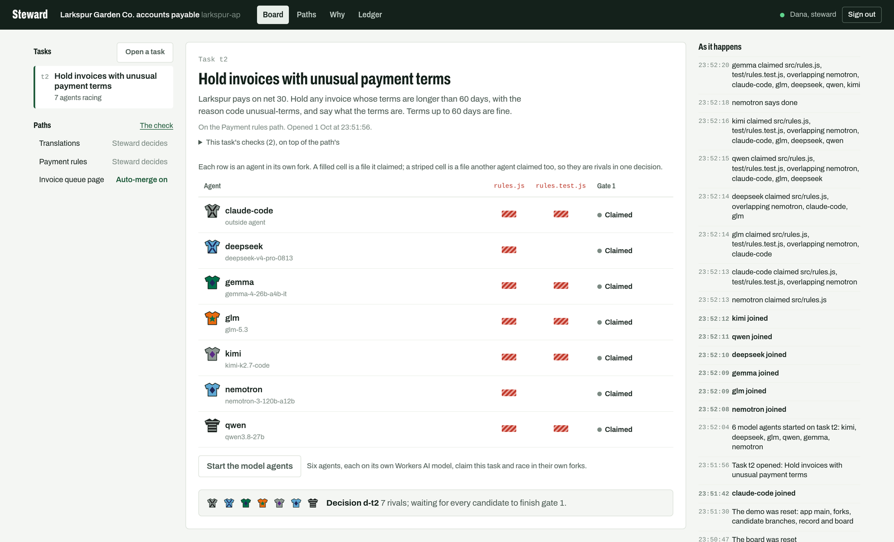
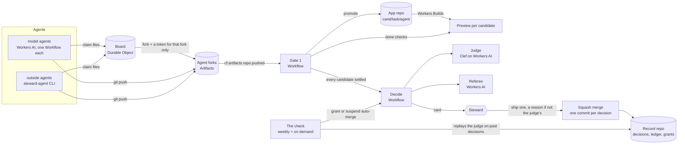

# Steward

Steward turns the pull request into a decision. Agents race in their own forks, a judge proposes one candidate, and a person, the steward, decides. Auto-merge is earned path by path and revoked when the judge drifts from the steward.

Code is now cheap and judgment is not, so the core object here is the decision, not the diff. It runs entirely on Cloudflare: Workers, Durable Objects, Workflows, Workers AI, Workers Builds and Previews, and [Artifacts](https://developers.cloudflare.com/artifacts/), Cloudflare's Git-speaking storage.

Live demo: [steward.craigm26.workers.dev](https://steward.craigm26.workers.dev). Anyone can watch; changing anything needs the steward key.



| The question | Steward's answer |
| --- | --- |
| How do agents know what others are working on? | A claims board shows who holds which files. |
| What happens when changes conflict? | Overlapping claims become rival candidates in one decision. |
| How do you review everything agents produce? | A mechanical gate checks all of it; the steward only makes taste calls. |
| How do you keep track of why a change was made? | Every merge writes a ledger entry, and why-blame reads it back for any line. |



## How it works



1. **Claims.** A steward opens a task on a path (a playbook: its files, its steward, its done checks, a budget, its taste rules). An agent claims the files it will touch. Steward forks the app for that agent alone and returns a write token scoped to that fork, so no agent ever holds a token for the app. Claims that share a file are rivals in one decision.
2. **Gate 1: does it work?** Every push to a fork starts a Workflow directly from the Artifacts event. It copies the commit to `cand/<task>/<agent>` on the app repo, waits for Workers Builds to run the build and tests and publish a Preview of exactly that commit, then probes the Preview with the task's checks and the path's regression checks. An agent that claims done and fails is bounced before anyone sees it, with the failing checks attached. A hedged summary ("I think this should work") counts as not done. An agent may change only the files it claimed.
3. **Gate 2: is it the one to ship?** When every rival has settled, a Workflow asks the judge to pick one and name the taste rule that decided it, and a referee on Workers AI posts the strongest objection to each candidate. The card shows the Previews side by side, the checks, the diff, the objection, and the agent's own summary last.
4. **The steward decides.** One click ships the judge's pick. Shipping another needs a reason, written into the record. The merge is a single squash commit on main with `Steward-Decision` trailers; Steward's working files never reach main.
5. **The record.** Every decision is a file in a record repo in Artifacts, with a line in `ledger.jsonl`. Why-blame walks main's history in the Worker and opens the decision behind any line: the task, the rivals it beat, the judge, the objection, who decided and why.
6. **The check.** Weekly, or on demand, the judge is replayed on the steward's past decisions for each path. A path whose judge matches the steward within the bar earns auto-merge as a grant; a check that finds drift suspends it. Only decisions a person made count as evidence. Even with auto-merge on, 1 in 10 still go to the steward.

The judge is [Clef](https://blog.cloudflare.com/clef-decision-models/), Cloudflare's decision model on Workers AI: it answers a typed question (which candidate ships, and which taste rule decided it) with calibrated probabilities in about half a second, through the same AI binding the agents use, so no key and nothing outside Cloudflare. The judgment pieces around it come from [PlatAtlas](https://platatlas.com), unchanged: the judgment contract (Jev's API, which Clef speaks), the thresholds reader, the grants rules, and the check report (see [`vendor/platatlas`](vendor/platatlas)). The rules about done, the referee, budgets, committed plans and evidence-first cards follow Anthropic's [Claude-shaped science](https://www.anthropic.com/research/claude-shaped-science).

## Run it on your own account

Your repos stay in your account, and an Artifacts namespace keeps every repo in the US or the EU, as you choose when you create it.

You need a Cloudflare account on Workers Paid (Artifacts requires it), Node 20 or later, and git.

```sh
git clone https://github.com/craigm26/steward && cd steward
npm install                      # pins wrangler 4.146; Artifacts needs 4.145 or later
npx wrangler login
```

Edit `wrangler.jsonc`: set `WORKERS_SUBDOMAIN` to your workers.dev subdomain. The namespace (`steward`), the app (`larkspur-ap`) and the record repo (`larkspur-ap.record`) can stay as they are. Then:

```sh
npx wrangler deploy
openssl rand -base64 32 | tr -d '\n' | npx wrangler secret put STEWARD_ADMIN_KEY
printf 'STEWARD_URL=https://steward.<your-subdomain>.workers.dev\nSTEWARD_ADMIN_KEY=<the same key>\n' > .dev.vars
node scripts/seed-app.mjs --jurisdiction us     # namespace, demo app repo, its Worker, the record
```

Then, once, in the dashboard: **Workers & Pages → larkspur-ap → Settings → Builds → Connect**, pick the Artifacts namespace and the `larkspur-ap` repo, set the build command to `npm run build`, save, and turn on **Builds for Preview branches**. (Connecting a Worker to an Artifacts repo is a dashboard step today.) Until it is connected, `node scripts/preview-runner.mjs` does the same job from your machine: it builds each candidate in a bubblewrap sandbox with no network and publishes its Preview with `wrangler preview`.

Open the board, sign in with the steward key, open a task (or one of the two demo tasks), and press **Start the model agents**.

The judge's engine is `judge.engine` in the record's `steward.yaml`: `clef` (the default), `clef-flash` (faster, a little less accurate here), `typesafe` (Jev, with `npx wrangler secret put TYPESAFE_API_KEY`), or `mock` (a deterministic rubric that needs nothing). A different judge can earn or lose auto-merge on different paths, so compare before switching: `node scripts/judge-eval.mjs --engines mock,clef,clef-flash --live` replays each on every decision a person made and saves nothing. On the demo's 24 such decisions, Clef and the rubric fail the same checks (payment rules 1 of 10 against the steward, the invoice queue page 3 of 8, translations 0 of 6), but Clef agreed with the steward's overrule on the terms race that the rubric got wrong. Jev (`typesafe`) has not been run on these decisions yet; `TYPESAFE_API_KEY=... node scripts/judge-eval.mjs --engines clef,typesafe --live` is the comparison.

## Agents

- **Model agents** run inside Cloudflare, one Workflow per agent, each on its own Workers AI model. The default lineup is Kimi K2.7 Code, DeepSeek V4 Pro, GLM 5.3, Qwen 3.8, Gemma 4 and Nemotron 3. Bounced by gate 1, an agent reads the failing checks and tries again while its decision is open.
- **Outside agents** (Claude Code, a script, a person) use [`agents/steward-agent.mjs`](agents/steward-agent.mjs): `tasks`, `claim <task> --dir <folder>` (clones your fork with its token), `status`, `done <task> --summary "…"`, `withdraw`. An admin key registers an agent with `register <name>`. In the explainer's run, Claude Code raced the six models this way and the board labeled it an outside agent.
- **Scripted agents** ([`agents/scripted.mjs`](agents/scripted.mjs)) push known variants, including a wrong one, to rehearse the loop without a model. They are labeled scripted everywhere they appear.
- **The scale run** (`POST /api/admin/scale`) puts six scripted agents on each of 20 translation tasks, 120 in all, inside Cloudflare. A translation is data, so its checks read the file at the candidate's commit and no Preview is built. Measured: every agent settled within about two minutes; the 80 broken files bounced at gate 1; on the Translations path, which had earned auto-merge, the judge merged 16 decisions alone and sent 4 to the steward.

## The record

| Path | What it holds |
| --- | --- |
| `steward.yaml` | The app, its Worker, the stewards, the judge's engine |
| `thresholds.yaml` | What the judge may decide alone |
| `playbooks/<path>.yaml` | Per path: its steward, files, done checks, budget, taste rules, auto-merge |
| `decisions/<id>.json` | One decision: the candidates, their evidence, the judge, the referee, the steward |
| `ledger.jsonl` | One line per merge: who decided and what merged |
| `checks/<path>/last-report.json` | The latest check of the judge against the steward |
| `preferences/grants.jsonl` | Auto-merge grants, append-only: earned, suspended, revoked |

## What is real and what is not

- The demo company, Larkspur Garden Co., and all its data are made up.
- The record starts with 22 synthetic past decisions (8 on payment rules, 8 on the invoice queue page, 6 on translations) so the check has history to replay on day one. They are marked `synthetic: true` and shown as synthetic.
- The judge is a model, Clef, and it can be wrong; the check exists to measure how often, path by path, against the steward. With `engine: mock` it is instead a rubric that scores evidence against the playbook's taste rules, deterministic and labeled mock, with a heuristic confidence.
- The referee is a real model on Workers AI, and it can be wrong; the steward reads it, it decides nothing.
- The explainer film is narrated by a synthetic voice (Aura-2 on Workers AI). Its product footage is the real UI replaying answers recorded during a live run.

## Costs

Everything runs on Workers Paid ($5 a month), which includes generous allowances. At the demo's scale (a few races a day) usage stays inside them, except Workers AI.

| Service | Paid plan allowance | Beyond it |
| --- | --- | --- |
| [Artifacts](https://developers.cloudflare.com/artifacts/platform/pricing/) (billing from Oct 14, 2026) | 10,000 operations and 1 GB a month | $0.15 per 1,000 operations; $0.50 per GB-month |
| [Workers AI](https://developers.cloudflare.com/workers-ai/platform/pricing/) | 10,000 Neurons a day | $0.011 per 1,000 Neurons |
| [Workflows](https://developers.cloudflare.com/workflows/reference/pricing/) | 500,000 steps and 30 million CPU ms a month | $0.80 per 100,000 steps |
| [Durable Objects](https://developers.cloudflare.com/durable-objects/platform/pricing/) | 1 million requests a month | $0.15 per million |

A race of six model agents makes two to four model calls per agent; most of its cost is those calls.

## Development

```sh
npm run typecheck
npx vitest run --pool=forks --maxWorkers=1
node scripts/watch.mjs --task t1           # the board from a terminal
node scripts/admin.mjs check rules         # run the check now
node scripts/judge-eval.mjs --live         # each judge engine against the steward's past picks, nothing saved
```

[`docs/DEMO.md`](docs/DEMO.md) covers recording a demo beat by beat, and rendering the explainer film from a recorded run.

## License

Apache-2.0 (see [LICENSE](LICENSE) and [NOTICE](NOTICE)). The files in `vendor/platatlas` keep their MIT License.
